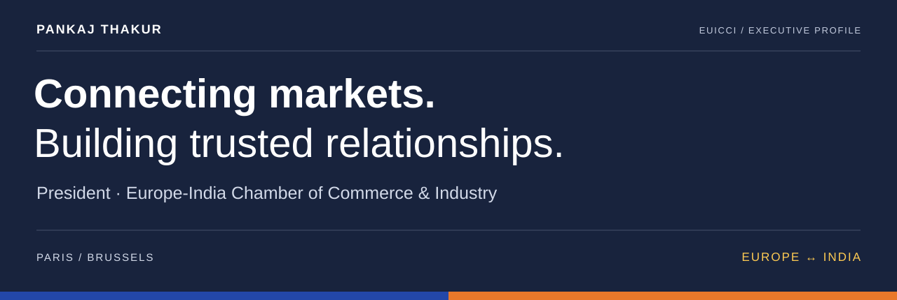
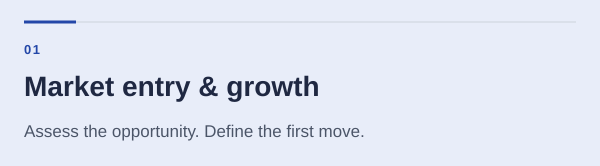
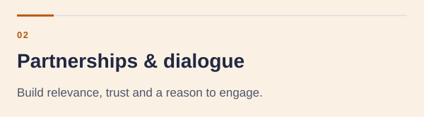
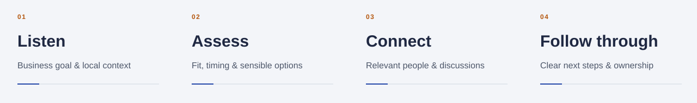

# Pankaj Thakur

### President, Europe-India Chamber of Commerce & Industry
**International growth · Commercial strategy · Strategic partnerships · Talent mobility**

Paris region, France · Active in Brussels · Europe–India focus

[EUICCI](https://www.euicci.com/) · [Leadership biography](https://www.euicci.com/about/) · [LinkedIn](https://www.linkedin.com/in/pankajvnt/) · [Start a conversation](https://www.euicci.com/contact/)

---

## Executive perspective

I lead the Europe-India Chamber of Commerce & Industry with a practical objective: help people and businesses make better decisions across borders, build relationships they can rely on and move from an initial opportunity to a workable next step.

My background spans more than a decade of international experience across Europe and Asia, working with entrepreneurs, growth-stage companies and international teams on market expansion, business development and commercial strategy. I combine that commercial perspective with an understanding of the local context, the people involved and the work required after a first introduction.

Through EUICCI, that focus connects three priorities: Indian companies entering Europe, European companies growing in India, and skilled professionals preparing for opportunities across the corridor.

## Leadership focus

<table>
<tr>
<td width="50%" valign="top">

**Strategic choice before expansion.** Assess market relevance, sharpen positioning and define a credible first move. Bring the offer, route to market, local relationships and execution priorities into the same conversation.

[Explore market-entry support](https://www.euicci.com/services/market-entry/)

</td>
<td width="50%" valign="top">

**Relationships with a clear purpose.** Create relevant conversations between founders, companies, advisers and decision makers. Carry the context from the first meeting into the discussions that follow.

[Explore business dialogues](https://www.euicci.com/business-dialogues/)

</td>
</tr>
<tr>
<td width="50%" valign="top">

**People as part of the growth strategy.** Connect employer needs with candidate preparation, local expectations and the practicalities of moving between markets. Keep fair recruitment and realistic guidance central.

[Explore employer support](https://www.euicci.com/employers/)

</td>
<td width="50%" valign="top">

**A useful platform for participation.** Connect membership, expert contributions, knowledge sharing and business advocacy. Help turn individual questions into conversations that benefit the wider business community.

[Explore membership and partnerships](https://www.euicci.com/membership/)

</td>
</tr>
</table>

## The decisions I help leaders frame

EUICCI's advisory work is organised around consequential choices rather than a generic expansion checklist.

| Leadership question | Focus of the work |
| --- | --- |
| **Is this the right next market?** | Market relevance, fit, timing and the assumptions worth testing before committing resources. |
| **Where should we begin?** | A European country or Indian location that fits the customer base, operating needs and first priorities. |
| **How should we enter?** | Comparing commercial routes, local partners and establishment options, with specialist input where required. |
| **Will the offer make sense locally?** | Positioning, messaging, pricing considerations and the route to early customers. |
| **Who needs to be involved?** | Founders, local leadership, commercial partners, advisers and the people responsible for follow-through. |
| **What makes the next step credible?** | A clear scope, relevant introductions, practical milestones and explicit ownership. |

[Market-entry advisory](https://www.euicci.com/services/market-entry/) · [Founder advisory](https://www.euicci.com/services/founder-advisory/) · [Growth consulting](https://www.euicci.com/services/growth-consulting/)

## From strategy to follow-through

**Listen.** Start with the business objective and the context behind it. Understand what the organisation needs to achieve and what is getting in the way.

**Assess.** Review fit, timing and the available options. Surface the questions that need research or specialist advice before a decision is made.

**Connect.** Bring relevant people into a focused discussion when there is a clear basis for collaboration.

**Follow through.** Keep the discussion connected to its purpose as it develops into a partnership, representation arrangement or commercial next step.

## Building the chamber platform

### Business dialogue and strategic relationships

EUICCI brings together professionals, founders and business decision makers through focused meetings, roundtables and small-group exchanges in Paris, Brussels and online. The purpose is to create space for useful discussion and relevant introductions, with attention to what happens after the meeting.

[Business dialogues](https://www.euicci.com/business-dialogues/) · [Strategic business support](https://www.euicci.com/services/strategic-business-support/)

### Membership, partnerships and expert participation

The chamber offers pathways for individuals, businesses and strategic partners. Participation can include knowledge contributions, sector discussions, joint initiatives and support for business dialogues. The emphasis is on relevance and continuity: a network becomes valuable through the quality of participation.

[Membership and partnership pathways](https://www.euicci.com/membership/)

### Business advocacy and cross-cultural understanding

Market access, partnership barriers, administrative friction and talent mobility are recurring subjects in the chamber's work. EUICCI's advocacy approach draws on concrete business experience and constructive proposals. Cross-cultural guidance adds another practical layer: how people communicate, make decisions and maintain trust across markets.

[Advocacy](https://www.euicci.com/advocacy/) · [Cross-cultural business guidance](https://www.euicci.com/services/cross-cultural-guidance/)

## Commercial breadth

The advisory platform addresses technology and digital services, industry and manufacturing, energy and sustainability, trade and market access, startups and professional services.

Talent-related guidance also covers fields including healthcare, engineering, hospitality, culinary work and skilled trades. The support required differs by sector; the common thread is understanding the local need before proposing a route forward.

[Consulting and advisory](https://www.euicci.com/services/) · [Sector guides](https://www.euicci.com/sectors/)

## Digital delivery and trusted knowledge

The public EUICCI platform turns complex cross-border questions into accessible guides, country information and clear enquiry routes. It separates professional mobility, employer needs and business expansion so visitors can find support relevant to their situation.

That reflects how I approach digital work: begin with the user's decision, structure the information around it and make the next action clear. Commercial judgement, useful content and a dependable digital experience need to work together.

## Continued professional development

My wider learning portfolio complements this leadership focus with training in AI, business analytics, product strategy, marketing operations and delivery.

| Portfolio | Related areas |
| --- | --- |
| [GrowthTribe](https://github.com/pktpankaj/GrowthTribe-Certificates) | AI literacy, business analytics, product strategy, growth and digital leadership |
| [CXL](https://github.com/pktpankaj/CXL) | Marketing leadership, analytics, commercial services and project delivery |
| [HubSpot Academy](https://github.com/pktpankaj/HubSpot) | Inbound strategy, customer communication, sales management and revenue operations |

---

## Connect

For conversations about Europe–India expansion, commercial partnerships, founder advisory or chamber participation:

[Contact EUICCI](https://www.euicci.com/contact/) · [Connect with me on LinkedIn](https://www.linkedin.com/in/pankajvnt/) · [Visit the chamber](https://www.euicci.com/)

<strong>About this repository</strong>

This is an executive profile and EUICCI portfolio repository. The existing [HTML concept preview](./euicci_chamber_grade_preview.html), [English language file](./en.json) and [French language file](./fr.json) are retained.

The [live website](https://www.euicci.com/) is the reference for current chamber services and guidance. The HTML preview is an earlier concept, rather than a copy of the current production website.

Profile scope is grounded in the chamber's [published leadership biography](https://www.euicci.com/about/), [advisory services](https://www.euicci.com/services/), [membership](https://www.euicci.com/membership/), [business dialogues](https://www.euicci.com/business-dialogues/) and [advocacy](https://www.euicci.com/advocacy/) pages.

